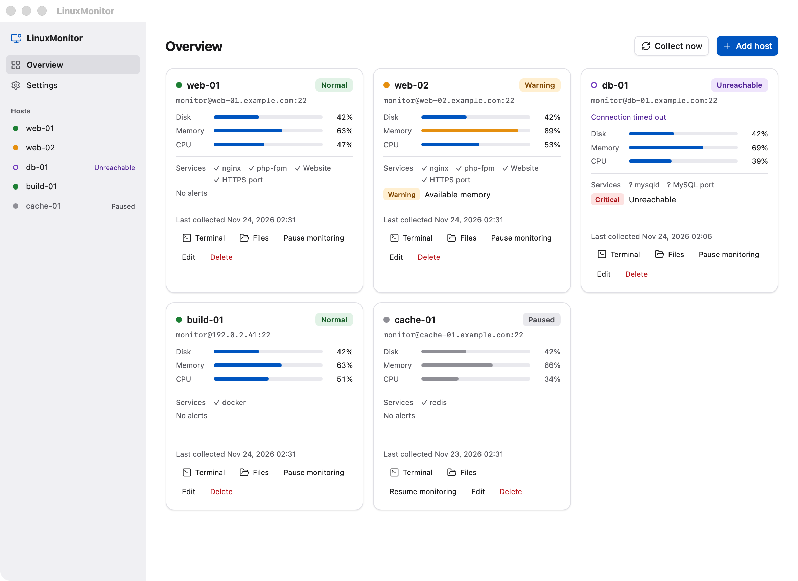
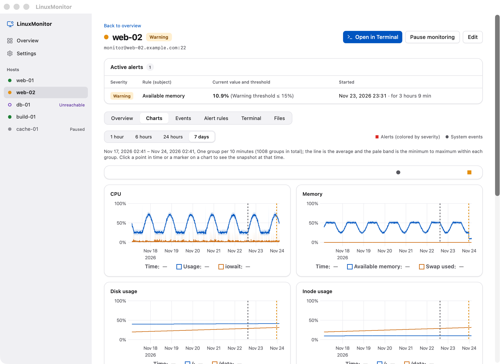
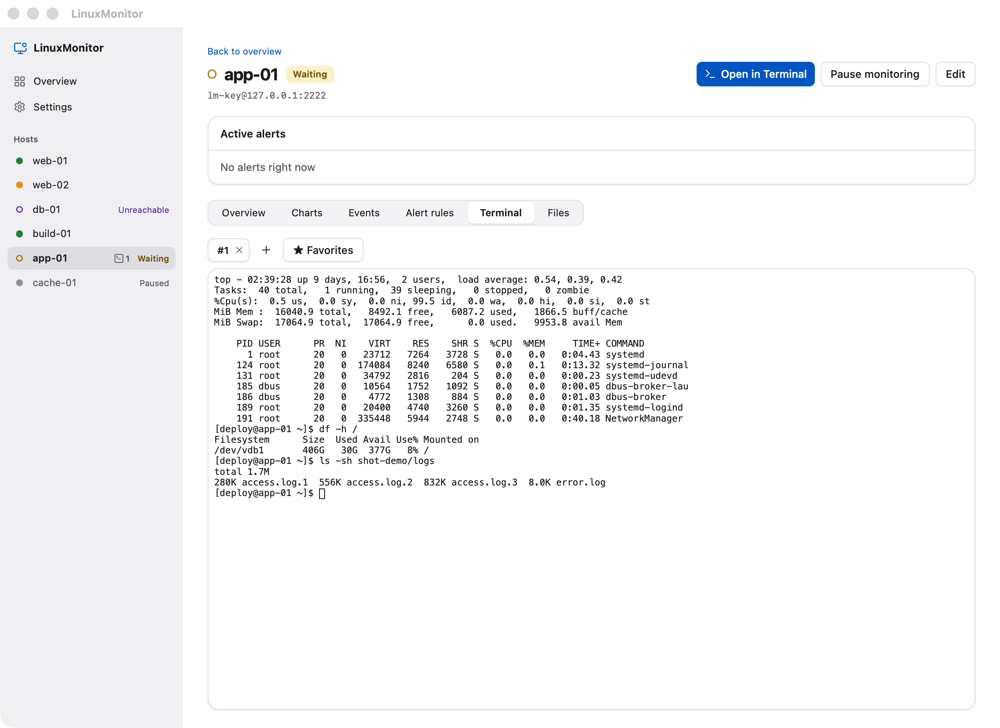
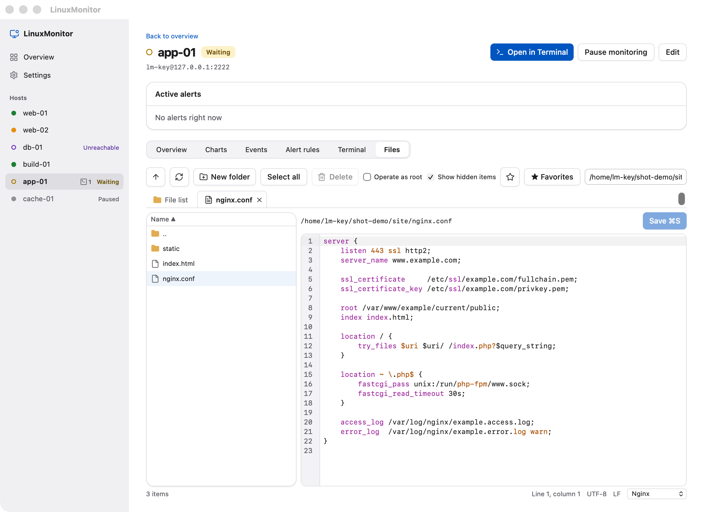
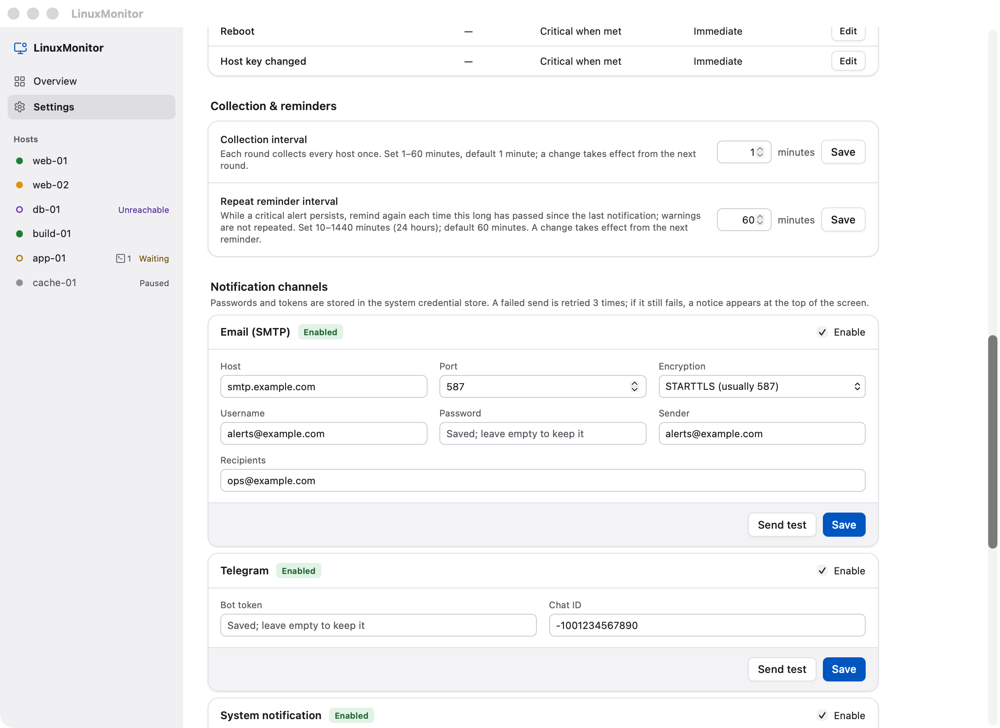

<div align="center">

# LinuxMonitor

**Monitor many Linux servers over plain SSH. Dashboards, alerts, a terminal and a file manager in one desktop app. Nothing to install on your servers.**

English | [繁體中文](README.zh-TW.md)

[](../../releases/latest)
%20%7C%20Windows%2010%20x64-lightgrey)

<picture>
  <source media="(prefers-color-scheme: dark)" srcset="images/overview-en-dark.png">
  
</picture>

</div>

## Features

- **Overview dashboard**: one card per host with CPU, memory, disk, load and a status light.
- **7-day charts**: one snapshot per minute; OOM kills, reboots and alerts are marked right on the charts.
- **Alerts**: threshold, state (service down, health check failed, unreachable, host key changed) and event rules. Delivered by Email, Telegram or system notification, with consecutive-failure counts to avoid noise.
- **Health checks**: command, HTTP, port and process checks that run on the host, with a "Test" button.
- **Built-in terminal** and **file manager** (SFTP, inline text editor, optional "as root"), using the same login as monitoring.
- **Upgrade advice**: based on 7 days of usage, tells you whether a host needs more CPU, memory or disk.
- Traditional Chinese and English UI, light and dark themes.

<table>
  <tr>
    <td><picture>
      <source media="(prefers-color-scheme: dark)" srcset="images/host-detail-en-dark.png">
      
    </picture></td>
    <td><picture>
      <source media="(prefers-color-scheme: dark)" srcset="images/terminal-en-dark.png">
      
    </picture></td>
  </tr>
  <tr>
    <td><picture>
      <source media="(prefers-color-scheme: dark)" srcset="images/files-en-dark.png">
      
    </picture></td>
    <td><picture>
      <source media="(prefers-color-scheme: dark)" srcset="images/alerts-en-dark.png">
      
    </picture></td>
  </tr>
</table>

> The screenshots use fictional demo data; the terminal and file screenshots come from a local test server.

## Install

Download the latest build from [Releases](../../releases/latest).

| Platform | File |
|---|---|
| macOS (Apple Silicon) | `.dmg`, drag into Applications |
| Windows 10 (x64) | `LinuxMonitor_<version>_x64-setup.exe` |

The macOS build is **not notarized**. If macOS blocks it, open System Settings → Privacy & Security and choose "Open Anyway", or run:

```bash
xattr -cr /Applications/LinuxMonitor.app
```

After the first install the app checks for updates every 24 hours and updates itself.

## Security and privacy

- **Agentless, no sudo**: each collection run pipes a read-only script to the host over SSH using an ordinary account. Nothing is installed or left behind.
- **Secrets stay in the OS credential store** (macOS Keychain / Windows Credential Manager); config files and the database contain none. Private keys are referenced by path, never copied.
- **You confirm host keys**: the first connection shows the fingerprint; if a key later changes, the app refuses to connect, sends no credentials and raises a critical alert.
- **Your data stays on your computer** in a single local SQLite file. No account, no cloud sync.
- **Outbound connections** are only: your own hosts (SSH), the notification channels you configure (SMTP, Telegram), and a signed update check against this repo's Releases.
- **Updates are signature-verified**; an update that fails verification is not installed.

## About this repository

This repository only hosts signed installers and the update manifest (`latest.json`). The source code is not public. Questions and feedback are welcome in [Issues](../../issues).
