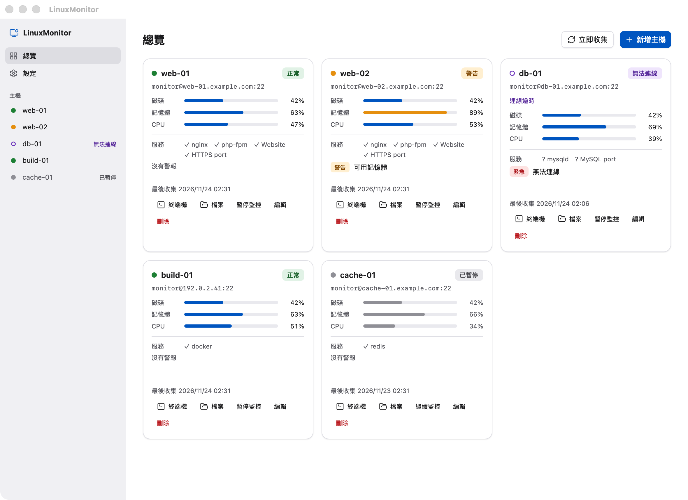
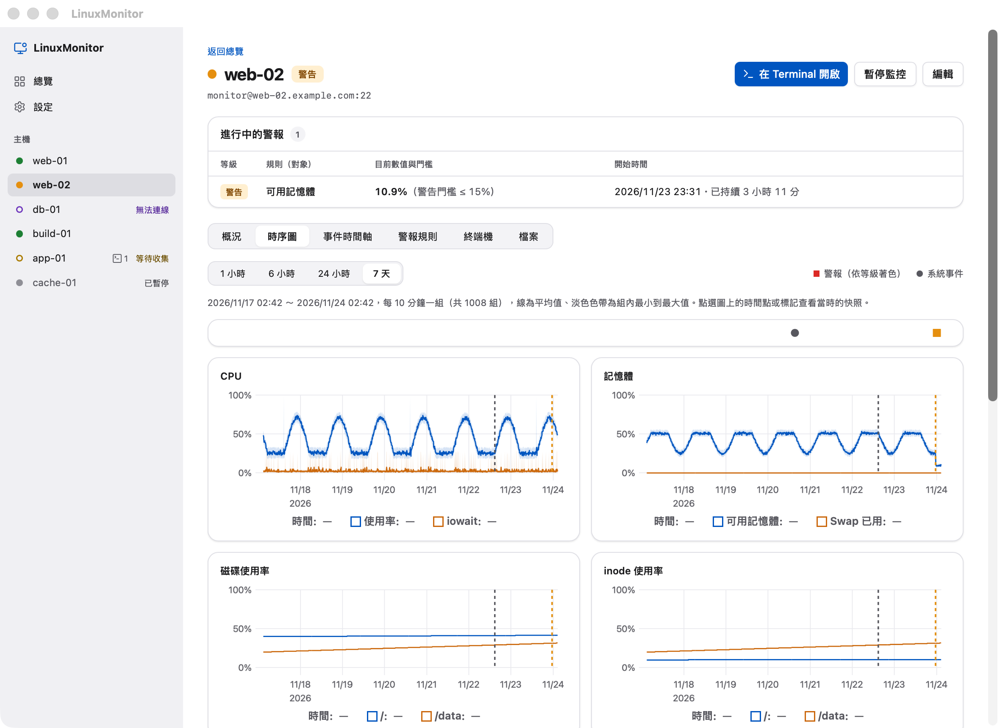
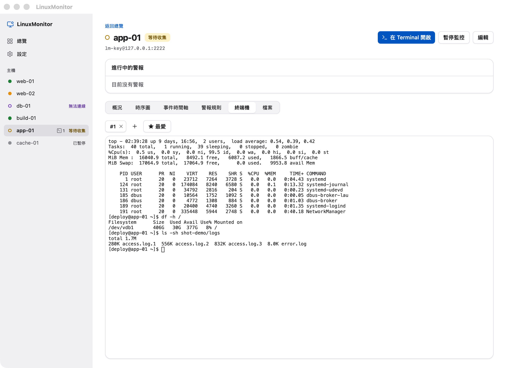
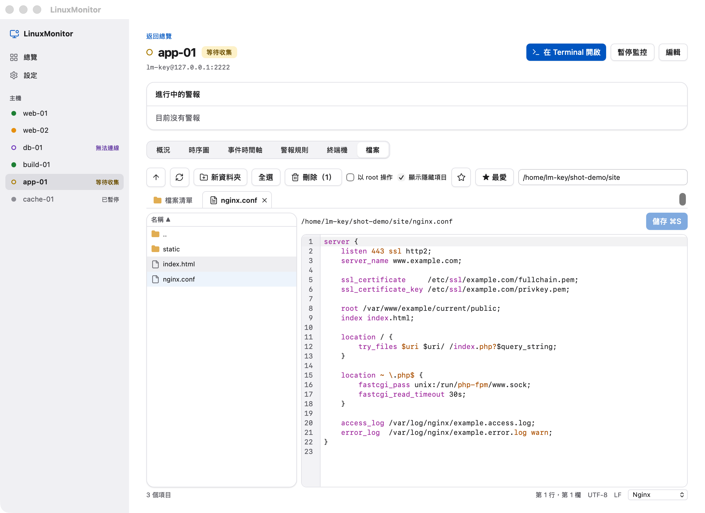
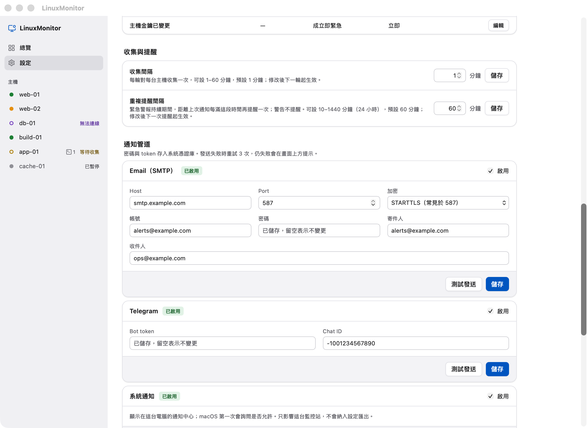

<div align="center">

# LinuxMonitor

**用 SSH 一次看管多台 Linux 主機：儀表板、警報、終端機與檔案管理都在同一個桌面程式裡，主機上不用裝任何東西。**

[English](README.md) | 繁體中文

[](../../releases/latest)
%20%7C%20Windows%2010%20x64-lightgrey)

<picture>
  <source media="(prefers-color-scheme: dark)" srcset="images/overview-zh-dark.png">
  
</picture>

</div>

## 功能

- **總覽儀表板**：每台主機一張卡片，CPU、記憶體、磁碟、負載與狀態燈號。
- **7 天時序圖**：每分鐘一份快照，OOM kill、重開機與警報直接標在圖上。
- **警報**：門檻型、狀態型（服務未執行、健康檢查失敗、無法連線、主機金鑰變更）與事件型規則；透過 Email、Telegram 或系統通知送出，連續 N 次才觸發，避免洗版。
- **健康檢查**：指令、HTTP、Port、行程檢查，在主機上執行，設定時可先按「測試」。
- **內建終端機**與**檔案管理**（SFTP、內嵌文字編輯器、可選「以 root 操作」），登入方式與監控相同。
- **升級建議**：依過去 7 天的使用量，判斷主機要不要加 CPU、記憶體或磁碟。
- 繁體中文與英文介面，淺色與深色主題。

<table>
  <tr>
    <td><picture>
      <source media="(prefers-color-scheme: dark)" srcset="images/host-detail-zh-dark.png">
      
    </picture></td>
    <td><picture>
      <source media="(prefers-color-scheme: dark)" srcset="images/terminal-zh-dark.png">
      
    </picture></td>
  </tr>
  <tr>
    <td><picture>
      <source media="(prefers-color-scheme: dark)" srcset="images/files-zh-dark.png">
      
    </picture></td>
    <td><picture>
      <source media="(prefers-color-scheme: dark)" srcset="images/alerts-zh-dark.png">
      
    </picture></td>
  </tr>
</table>

> 截圖使用虛構的展示資料；終端機與檔案的截圖來自本機測試主機。

## 安裝

到 [Releases](../../releases/latest) 下載最新版。

| 平台 | 檔案 |
|---|---|
| macOS（Apple Silicon） | `.dmg`，拖進「Applications」 |
| Windows 10（x64） | `LinuxMonitor_<版本>_x64-setup.exe` |

Mac 版**尚未經過 Apple 公證**。若被 macOS 擋下，到「系統設定 → 隱私權與安全性」按「仍要打開」，或在終端機執行：

```bash
xattr -cr /Applications/LinuxMonitor.app
```

第一次安裝後，程式每 24 小時自動檢查更新並自行更新。

## 安全與隱私

- **免安裝、不用 sudo**：每輪收集透過 SSH 把唯讀腳本傳到主機，以一般帳號權限執行，不安裝也不留下任何東西。
- **秘密存在系統憑證庫**（Mac 鑰匙圈／Windows 認證管理員），設定檔與資料庫都不含秘密；私鑰只記路徑，不會複製。
- **主機金鑰由你確認**：第一次連線顯示指紋；之後金鑰若改變，程式拒絕連線、不送出憑證，並發出緊急警報。
- **資料只在你的電腦上**，存成單一本機 SQLite 檔；沒有帳號、沒有雲端同步。
- **對外連線只有**：你自己的主機（SSH）、你設定的通知管道（SMTP、Telegram），以及向本 repo Releases 做的簽章更新檢查。
- **更新會驗證簽章**，驗證不過就不安裝。

## 關於這個 repo

這裡只放已簽章的安裝檔與更新清單（`latest.json`），不公開原始碼。問題與建議歡迎到 [Issues](../../issues) 提出。
